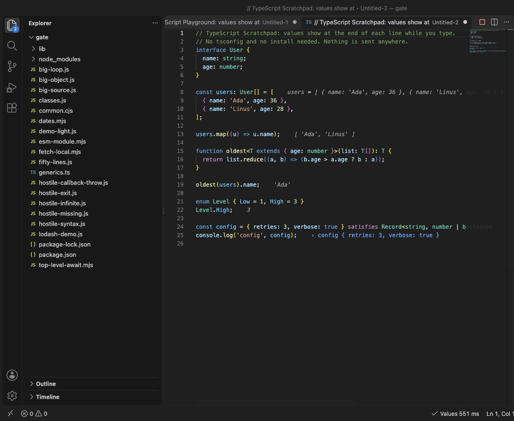
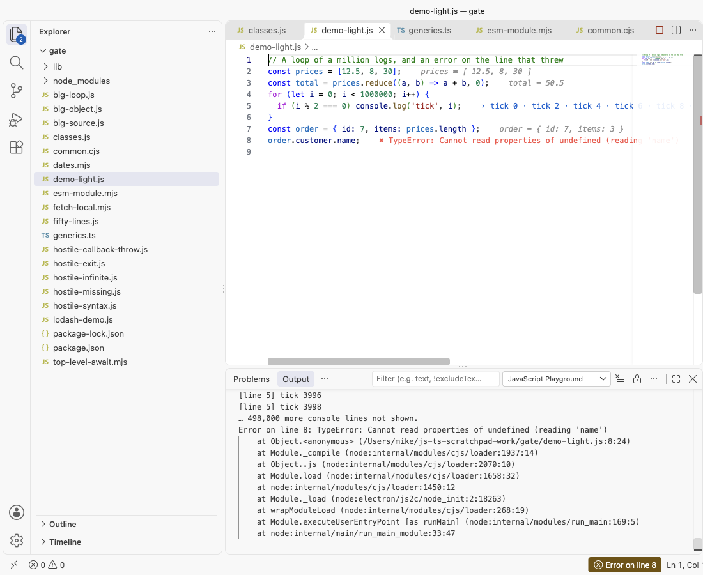

# JavaScript Playground & TypeScript Scratchpad with Inline Values (Live JS and TS Runner)

Type JavaScript or TypeScript and see the value of each line at the end of that line, while you type. `console.log` output and errors land on their own lines too. Free, no sign-in, works offline. No popups, no "what's new" page, no ads.

- Open a scratchpad in one click: New JavaScript Scratchpad or New TypeScript Scratchpad. Values show in under a second.
- Or click Inline Values in the status bar of any `.js`, `.mjs`, `.cjs`, `.ts`, `.mts` or `.cts` file. Imports and `require` resolve from that file's folder and your `node_modules`.
- TypeScript with no setup: no tsconfig, no install. Types, interfaces, generics, enums and `satisfies` just work.
- Safe by design: each run is a fresh process with a time limit (5 s) and a memory limit. An endless loop is stopped and VS Code stays responsive.

## Start in ten seconds

1. Open the Command Palette (`Cmd+Shift+P` or `Ctrl+Shift+P`) and run JavaScript Playground, New JavaScript Scratchpad.
2. Change a number. The values update about 300 ms after you stop typing.

That is all. The Get Started page (JavaScript Playground, Get Started) shows the same steps with buttons.

## What you see

| On the line | Example |
|---|---|
| The value of an expression | `nums.sort()` shows `[ 1, 2, 3 ]` |
| The value of a new variable | `const total = 42` shows `total = 42` |
| `console.log`, `info`, `warn`, `error`, `table`, `dir` | `› n is 3` |
| A promise | `Promise → 42` once it settles |
| A loop | `0 · 1 · 2 · 3 … (+999,996 more)` |
| An error | `✖ TypeError: Cannot read properties of undefined` on the line that threw |

Hover a value to see more of it (objects to depth 2, long values in full up to 2,000 characters). The JavaScript Playground output panel has the full console output and each error's stack, with your file's real path and line numbers. Click the status bar item to open it.

## Large output and hostile code

- A loop that logs a million times keeps the first 100 values of each line and counts the rest. The output panel keeps the first 2,000 lines of each run. The editor stays fast and the extension's memory stays flat.
- `while (true) {}` is stopped at the time limit (setting `jsScratchpad.timeoutSeconds`), with a clear message on the line.
- `process.exit()`, a throw inside a callback, an unhandled promise rejection and a missing module all show on their line. A syntax error while you type shows on its line and the last values stay.
- Large objects print to depth 2 with the first 50 items of arrays, maps and sets, and the first 50 keys of very wide objects.
- Files over 100 KB are prepared in a background thread, so typing never waits. Files over 512 KB run when you save instead of on every key press.

## Settings

| Setting | Default | What it does |
|---|---|---|
| `jsScratchpad.runOn` | `change` | Run after each edit, or only on save |
| `jsScratchpad.debounceMs` | 300 | Wait after the last key press |
| `jsScratchpad.timeoutSeconds` | 5 | Stop a run after this long |
| `jsScratchpad.memoryLimitMB` | 1024 | Memory limit of each run |
| `jsScratchpad.runtime` | `vscode` | VS Code's own Node.js, or `node` from your PATH (any version you have) |
| `jsScratchpad.nodePath` | empty | Full path of a node program |
| `jsScratchpad.moduleType` | `auto` | ES module or CommonJS; `require` and top-level `await` work in both |
| `jsScratchpad.maxValuesPerLine` | 100 | Values kept per line before it only counts |
| `jsScratchpad.scratchFolder` | empty | Save new scratchpads in a folder instead of untitled tabs |

Other commands: Run Now, Stop Inline Values, Clear Values, Show Console Output, Show All Values of This Line (every value a loop line took), Copy Code with Values as Markdown, Show Which Lines Ran.

## Why this one

Rival reviews and issues from 2025 and 2026 name the same problems again and again. This extension was built to fix them, and each fix was checked in a real VS Code.

| What users reported | Where | Here |
|---|---|---|
| "using notifications and the 'what's new' page to constantly advertise" (May 2025); notifications that advertise other services (Nov 2025, Jan 2025) | [reviews of a popular scratchpad extension](https://marketplace.visualstudio.com/items?itemName=WallabyJs.quokka-vscode&ssr=false#review-details) | 0 notifications and 0 promotion during our real VS Code test of 17 files and 2 scratchpads (counted). No what's-new page. The only message it can ever show by itself is one rating question, at most twice in total, after several days of use; one setting turns it off. |
| "For beginners, this does not work at all. No instructions on how to view logs" (Oct 2025) | [same reviews](https://marketplace.visualstudio.com/items?itemName=WallabyJs.quokka-vscode&ssr=false#review-details) | One click opens a scratchpad that already shows values, logs on their lines and a status bar item that opens the full log. Measured in real VS Code: values on screen about 0.5 s after the command. |
| "node v22.17.1 is not yet supported in the Community edition" (Aug 2025) | [reviews of a console log extension](https://marketplace.visualstudio.com/items?itemName=WallabyJs.console-ninja&ssr=false#review-details) | No Node version check at all. It runs on the Node.js inside VS Code (no install), or on any node you point it to. |
| TypeScript needs setup | | TypeScript runs with no tsconfig and no install; types are removed on the fly with exact line numbers. |

This extension is not made by, and does not replace, the extensions linked above.

## Privacy and safety

- The extension makes no network calls and has no telemetry. Your own code may use the network when you run it, like any script.
- In Restricted Mode (a folder you have not trusted) no code runs, and the editor says why.
- Your code runs as a separate process on your computer, from a temporary copy that is deleted after each run. It can read and write files like any Node.js script, so only run code you trust.

## Free

Every feature is free: no account, no trial, no limits.

## Limits

- Values show for expression statements and new variables, not inside every sub-expression.
- `.jsx` and `.tsx` files are not run. A `.ts` file that imports another `.ts` file needs Node 22.6 or newer as your node (setting `jsScratchpad.runtime`), because the imported file is not converted.
- Browser APIs like `document` do not exist; this is Node.js.

## Support Zovo

Zovo extensions are free, with no ads and no tracking. They are made by [theluckystrike](https://github.com/theluckystrike) on GitHub. If this one saves you time, you can support the work:

- [Sponsor on GitHub](https://github.com/sponsors/theluckystrike)
- [PayPal](https://www.paypal.com/paypalme/najzzz)
- [Follow theluckystrike on GitHub](https://github.com/theluckystrike)

## More tools by Zovo

- [Code Screenshot & Code Snapshot (Copy Code as Image, PNG/SVG)](https://marketplace.visualstudio.com/items?itemName=zovo.zovo-code-screenshot) Code screenshot and code snapshot in one key: select code, press Cmd+Alt+C (Shift+Alt+C) and a PNG of it is on your clipboard, in your editor theme, font and colors. Save PNG or SVG, line numbers, highlights, window frame, backgrounds. Free, no sign-in, works offline.
- [Regex Preview & Regex Tester (Railroad Diagram Visualizer, Groups)](https://marketplace.visualstudio.com/items?itemName=zovo.zovo-regex-preview) Regex preview and regex tester beside your code: click "Test regex" above a regex in JS, TS, Python, Go, Java, C#, PHP, Ruby or Rust. Capture groups, replace preview, railroad diagram visualizer, explain mode, flavor warnings. Free, no sign-in, works offline.
- [Large JSON Viewer, JSON Browser & JSON Tree](https://marketplace.visualstudio.com/items?itemName=zovo.zovo-json-tree-viewer) shows large JSON files as a searchable tree, copies JSONPath and turns arrays of objects into a table.
- [HAR Viewer & HAR File Analyzer (HTTP Archive, Network Log)](https://marketplace.visualstudio.com/items?itemName=zovo.zovo-har-viewer) opens HAR files from browser DevTools with a timing waterfall, filters and a redacted copy for sharing.
- [JSONL Viewer, Large JSONL Table & NDJSON Viewer](https://marketplace.visualstudio.com/items?itemName=zovo.zovo-jsonl-viewer) opens JSONL and NDJSON files as a table, as records or as a chat view.

See [all Zovo extensions on the Marketplace](https://marketplace.visualstudio.com/publishers/zovo).

## More from zovo

- [All free zovo VS Code extensions](https://marketplace.visualstudio.com/publishers/zovo) — file viewers, database clients, formatters. Offline, no telemetry, no sign-up.
- [Full MCP server catalogue](https://theluckystrike.github.io/mcp/) — local-first MCP servers for back-office work: invoices, VAT, PDFs, spreadsheets, payroll.
- [Hosted no-install MCP endpoints](https://mcp.zovo.one) — paste a URL in Claude / Cursor, nothing to install.
